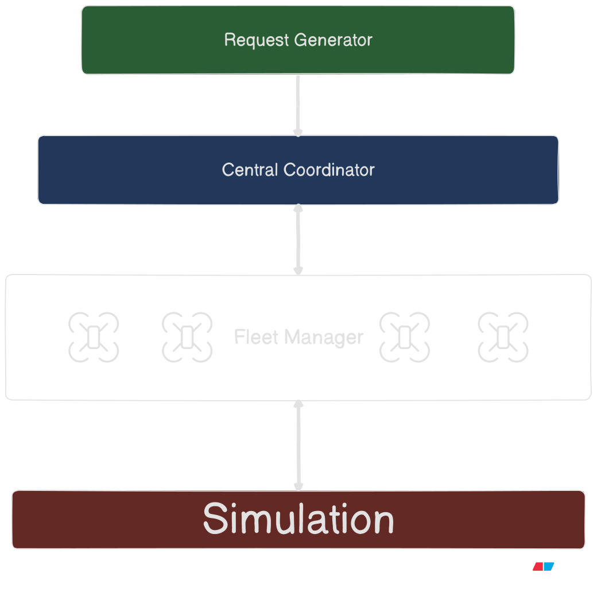

# AeroFleet
### An RL Based UAV delivery based multi-agent system along with a central RL based fleet coordinator.

 

 
A high level design objective of the project.

## Modules
- Request Generator
- Central Coordinator
- UAV Agent
- City Simulator
- Traning Module (Central Coordinator)
- Training Module (UAV Agent)

## The Training Loop Architecture
Policy A: Individual UAV agent

Objective: execute an assigned delivery safely and efficiently.
Observation
- Drone position, velocity, and orientation.
- Relative position of the current waypoint.
- Remaining battery and payload.
- Nearby obstacles and nearby UAVs.
- Optionally, wind and other environmental conditions.
Action
Continuous desired velocity or acceleration, subject to flight constraints.
Reward
- Positive reward for progress toward the waypoint.
- Large penalty for collision.
- Energy consumption penalty.
- Positive reward for reaching the waypoint.
- Penalties for unsafe or prolonged flight.

Policy B: Central coordinator

Objective: maximize fleet-level delivery performance.
Observation
- Pending requests, their ages, priorities and destinations.
- UAV positions, battery, payload capacity and operational status.
- Estimated travel times and energy requirements.
- Current assignments and estimated completion times.
- Queue length, recent delivery throughput and missed deadlines.
Action
Assign a feasible request to a UAV, defer a request, or wait for more information. Later, you can add reassignment, charging and fleet repositioning decisions.
Reward
- Successful deliveries and high throughput.
- Lower delivery latency and energy consumption.
- Penalties for missed deadlines, failed requests and unnecessary waiting.
- Penalties for collisions or unsafe assignments, although physical safety must still be enforced independently.

## RL Traning Architecture
