# AeroFleet: 20-Step Phase-Wise Development and Testing Plan

## 1. Executive Summary & Architectural Overview

**AeroFleet** is an end-to-end reinforcement-learning-driven simulation of an autonomous urban Unmanned Aerial Vehicle (UAV) delivery fleet. Delivery requests arrive dynamically from stores and customers across an urban terrain. A **Central Fleet Coordinator** allocates feasible deliveries to candidate UAVs, while an **Autonomous UAV Navigation Policy** guides individual drones through 3D urban air corridors, avoiding static buildings and dynamic UAV traffic while managing finite battery reserves.

### Architectural Core Principles
1. **C++ as the Authoritative Simulator**: All world geometry, rigid kinematics, swept collision detection (CCD), battery discharge/recharge dynamics, delivery state machines, and real-time execution live in high-performance C++. Rendering and external wrappers are non-authoritative clients.
2. **Python as the Learning Environment**: `pybind11` exposes the C++ simulation core to Gymnasium without duplicating physical or geometrical logic.
3. **Dual-Tier Hierarchical AI**:
   - **Local Navigation Controller (Policy A)**: High-frequency (10–20 Hz) continuous velocity/acceleration control with local obstacle avoidance and target tracking.
   - **Central Fleet Coordinator (Policy B)**: Low-frequency (1 Hz) combinatorial dispatch agent with action masking, managing queue throughput, battery constraints, and deadline margins.
4. **Decoupled 3D Visualization**: raylib visualizes immutable `WorldSnapshot` instances on the main thread or render thread without mutating physical state.
5. **Deterministic Production Pipeline**: Policies are trained in PyTorch/Gymnasium, verified for parity, exported to ONNX, and deployed natively in C++ via ONNX Runtime with an invariant Safety Layer.

---

## 2. Target Directory & Module Structure

```text
AeroFleet/
├── CMakeLists.txt
├── README.md
├── AeroFleet_Complete_Project_Design.md
├── development_plan.md
├── config/
│   ├── simulation.json
│   ├── city_default.json
│   ├── training_nav.yaml
│   └── training_coordinator.yaml
├── cpp/
│   ├── core/
│   │   ├── Types.hpp
│   │   ├── Config.hpp
│   │   ├── Config.cpp
│   │   ├── SimulationClock.hpp
│   │   ├── WorldState.hpp
│   │   ├── Simulator.hpp
│   │   └── Simulator.cpp
│   ├── math/
│   │   ├── Vec3.hpp
│   │   ├── MathUtils.hpp
│   │   └── Geometry.hpp
│   ├── world/
│   │   ├── CityMap.hpp
│   │   ├── WorldGenerator.hpp
│   │   └── WorldGenerator.cpp
│   ├── physics/
│   │   ├── Kinematics.hpp
│   │   ├── Kinematics.cpp
│   │   ├── CollisionSystem.hpp
│   │   ├── CollisionSystem.cpp
│   │   ├── BatteryModel.hpp
│   │   └── BatteryModel.cpp
│   ├── fleet/
│   │   ├── UAVState.hpp
│   │   ├── FleetManager.hpp
│   │   └── FleetManager.cpp
│   ├── requests/
│   │   ├── DeliveryRequest.hpp
│   │   ├── RequestGenerator.hpp
│   │   └── RequestGenerator.cpp
│   ├── coordinator/
│   │   ├── ICoordinator.hpp
│   │   ├── HeuristicCoordinator.hpp
│   │   ├── HeuristicCoordinator.cpp
│   │   ├── ONNXCoordinator.hpp
│   │   └── ONNXCoordinator.cpp
│   ├── control/
│   │   ├── INavigationPolicy.hpp
│   │   ├── WaypointController.hpp
│   │   ├── WaypointController.cpp
│   │   ├── ONNXNavigationPolicy.hpp
│   │   ├── ONNXNavigationPolicy.cpp
│   │   ├── SafetyLayer.hpp
│   │   └── SafetyLayer.cpp
│   ├── inference/
│   │   ├── ONNXModel.hpp
│   │   └── ONNXModel.cpp
│   ├── visualization/
│   │   ├── Renderer.hpp
│   │   ├── Renderer.cpp
│   │   ├── CameraController.hpp
│   │   └── CameraController.cpp
│   ├── telemetry/
│   │   ├── Logger.hpp
│   │   ├── Logger.cpp
│   │   ├── Metrics.hpp
│   │   └── Metrics.cpp
│   └── main.cpp
├── python/
│   ├── bindings/
│   │   └── aerofleet_bindings.cpp
│   ├── aerofleet/
│   │   ├── __init__.py
│   │   ├── nav_env.py
│   │   ├── coordinator_env.py
│   │   ├── observations.py
│   │   └── rewards.py
│   ├── train_nav.py
│   ├── train_coordinator.py
│   ├── evaluate_nav.py
│   ├── evaluate_coordinator.py
│   ├── export_onnx.py
│   └── verify_onnx_parity.py
├── models/
│   ├── navigation/
│   │   ├── nav_policy.onnx
│   │   ├── normalization.json
│   │   └── manifest.json
│   └── coordinator/
│       ├── coord_policy.onnx
│       ├── normalization.json
│       └── manifest.json
├── tests/
│   ├── test_math_geometry.cpp
│   ├── test_world_generation.cpp
│   ├── test_kinematics.cpp
│   ├── test_collision.cpp
│   ├── test_battery.cpp
│   ├── test_requests.cpp
│   ├── test_fleet_manager.cpp
│   ├── test_heuristic_nav.cpp
│   ├── test_heuristic_coordinator.cpp
│   ├── test_differential_physics.py
│   ├── test_onnx_runtime.cpp
│   └── test_reproducibility.cpp
└── logs/
```

---

## 3. The 20-Step Phase-Wise Master Plan

```mermaid
flowchart TD
    subgraph Phase1["Phase I: Foundation & Math Core"]
        S1["Step 1: Build System & Config"] --> S2["Step 2: 3D Math & Geometry"]
        S2 --> S3["Step 3: World & City Generator"]
    end

    subgraph Phase2["Phase II: Authoritative C++ Simulation Core"]
        S3 --> S4["Step 4: UAV Kinematics"]
        S4 --> S5["Step 5: Continuous Collision Detection"]
        S5 --> S6["Step 6: Battery & Energy Dynamics"]
    end

    subgraph Phase3["Phase III: Fleet Lifecycle & Baseline Logistics"]
        S6 --> S7["Step 7: Request Lifecycle & Poisson Generator"]
        S7 --> S8["Step 8: Fleet State Machine"]
        S8 --> S9["Step 9: Baseline Heuristic Navigator"]
        S9 --> S10["Step 10: Baseline Heuristic Coordinator"]
    end

    subgraph Phase4["Phase IV: Visualization & Telemetry"]
        S10 --> S11["Step 11: 3D raylib Visualizer & HUD"]
        S11 --> S12["Step 12: High-Speed Telemetry & Metrics"]
    end

    subgraph Phase5["Phase V: Python Gymnasium Environment"]
        S12 --> S13["Step 13: pybind11 C++ Bindings"]
        S13 --> S14["Step 14: Gymnasium Nav Environment"]
        S14 --> S15["Step 15: Cross-Language Differential Parity"]
    end

    subgraph Phase6["Phase VI: Navigation RL & ONNX Deployment"]
        S15 --> S16["Step 16: PPO Navigation Training & Curriculum"]
        S16 --> S17["Step 17: ONNX Actor Export & Dual Parity"]
        S17 --> S18["Step 18: C++ ONNX Runtime & Safety Layer"]
    end

    subgraph Phase7["Phase VII: Coordinator RL & System Convergence"]
        S18 --> S19["Step 19: Fleet Coordinator RL Training"]
        S19 --> S20["Step 20: Full Integration & Stress Benchmarking"]
    end
```



---

### PHASE I: FOUNDATION & MATHEMATICAL CORE

#### Step 1: Project Build System, Dependencies & Central Configuration
- **Objective**: Establish a hermetic, cross-platform build system (`CMake`) managing dependencies (`raylib`, `pybind11`, `onnxruntime`, `nlohmann_json`, `Catch2`) and a strongly typed simulation configuration loader.
- **Development Scope**:
  - Author top-level `CMakeLists.txt` supporting both C++ executable targets and Python C-extension shared libraries.
  - Implement `cpp/core/Config.hpp` and `cpp/core/Config.cpp` using `nlohmann_json` to load `config/simulation.json`.
  - Define world boundaries (`x_min, x_max, y_min, y_max, z_min, z_max`), simulation timesteps (`dt_physics = 0.02s`, `dt_policy = 0.10s`, `dt_coordinator = 1.00s`), and fleet limits.
- **Testing & Verification**:
  - Build verification: `cmake -B build -S . && cmake --build build --parallel`.
  - Unit test `test_config`: Validate JSON parsing, default fallback values, and schema bounds checking.
  - Assert that missing or malformed configuration keys throw explicit descriptive runtime exceptions instead of silent defaults.
- **Error Diagnostics & Remediation**:
  - *Error: Package `onnxruntime` or `raylib` not found.*
    - Action: Check `CMAKE_PREFIX_PATH` or install system dependencies via `apt install libraylib-dev` / download official ONNX Runtime prebuilt binaries into `third_party/`.
  - *Error: Compiler fails on C++20 features.*
    - Action: Verify `target_compile_features(AeroFleetCore PUBLIC cxx_std_20)` in `CMakeLists.txt` and ensure GCC >= 11 or Clang >= 13 is active.
  - *Error: JSON validation failure at startup.*
    - Action: Inspect `config/simulation.json` using `jq . config/simulation.json`. Check for negative physical values (e.g., negative speeds or timestep $\le 0$).

---

#### Step 2: 3D Vector Math, Spatial Primitives & Bounding Volumes
- **Objective**: Implement a zero-allocation, SIMD-friendly 3D math and bounding volume library for physical kinematics and geometric intersection tests.
- **Development Scope**:
  - Create `cpp/math/Vec3.hpp`: Vector addition, subtraction, scalar multiplication, dot product, cross product, magnitude, squared magnitude, normalization, distance, linear interpolation (`lerp`), and angle between vectors.
  - Implement `cpp/math/Geometry.hpp`:
    - `AABB` (Axis-Aligned Bounding Box: `minPoint`, `maxPoint`, center, extents).
    - `Sphere` (center, radius).
    - `Capsule` (segment point A, segment point B, radius).
    - `Ray` (origin, direction).
  - Implement intersection primitives: `Sphere-AABB`, `Capsule-AABB`, `Ray-AABB` (Slab method), and `Sphere-Sphere`.
- **Testing & Verification**:
  - Test file: `tests/test_math_geometry.cpp`.
  - Tests:
    - Normalizing a zero vector returns zero vector or throws defined exception (no NaN generation).
    - Ray-AABB intersection correctly determines entrance and exit scalar parameters $t_{near}$ and $t_{far}$.
    - Point-AABB distance clamped calculation returns exact Euclidean distance.
    - Capsule-AABB intersection matches manual geometric projections for orthogonal and diagonal orientations.
- **Error Diagnostics & Remediation**:
  - *Error: Division by zero or NaN propagation in `Vec3::normalized()`.*
    - Action: Guard normalization with an epsilon check: `if (magSq < 1e-12) return Vec3(0, 0, 0);`.
  - *Error: Ray-AABB false negatives for parallel rays.*
    - Action: In the Slab test, when ray direction component is near zero ($|d_i| < \epsilon$), check if origin lies inside box boundaries; do not compute $1.0 / 0.0$.
  - *Error: Precision drift in tight boundary contacts.*
    - Action: Use double-precision floating point (`double`) across all physical vectors and geometric scalars.

---

#### Step 3: Procedural City Map Generator & World Representation
- **Objective**: Generate a deterministic 3D urban environment containing static buildings, no-fly zones, store hubs, customer drop points, and charging stations.
- **Development Scope**:
  - Implement `cpp/world/CityMap.hpp`:
    - Storage for world extents, building list (`std::vector<AABB>`), store coordinates (`std::vector<Vec3>`), customer coordinates (`std::vector<Vec3>`), and charging stations (`std::vector<ChargingStation>`).
  - Implement `cpp/world/WorldGenerator.hpp` and `.cpp`:
    - Procedural grid layout with configurable street width, building block size, and building height sampling (e.g., Uniform, Gaussian, or Log-Normal).
    - Deterministic PRNG seeded via `uint64_t seed` using `std::mt19937_64`.
    - Spatial grid partition / uniform grid broadphase for fast spatial lookup of nearby buildings.
- **Testing & Verification**:
  - Test file: `tests/test_world_generation.cpp`.
  - Tests:
    - Seed determinism: Two generators initialized with seed `0xDEADBEEF` must produce identical building coordinates byte-for-byte.
    - Geometric validity: Assert no building footprints overlap unless explicitly configured.
    - Landmark validity: Assert no store, customer, or charging station coordinates fall within any building AABB (minimum clearance margin $\ge 2.0$ meters).
    - Bound containment: All entities reside within the configured world volume.
- **Error Diagnostics & Remediation**:
  - *Error: Generator enters infinite retry loop placing landmark points.*
    - Action: Track placement iterations with a hard counter (`max_retries = 1000`). If exceeded, log `WorldGeneratorException: City density too high to allocate safe landmarks` and abort with actionable suggestions to increase world size or reduce building density.
  - *Error: Non-deterministic maps between platforms.*
    - Action: Avoid `std::rand()` or platform-dependent distributions. Rely strictly on `std::mt19937_64` and standardize distribution formulas.

---

### PHASE II: AUTHORITATIVE C++ SIMULATION CORE

#### Step 4: UAV Rigid Kinematics & Motion Integrator
- **Objective**: Implement rigid physical integration governing UAV movement under bounded velocity, acceleration, turning rate, and aerodynamic limits.
- **Development Scope**:
  - Implement `cpp/fleet/UAVState.hpp`: Struct with `id`, `position`, `velocity`, `acceleration`, `yaw`, `batteryPercent`, `payloadMass`, `mode`, `targetWaypoint`.
  - Implement `cpp/physics/Kinematics.hpp` and `.cpp`:
    - Numerical integrator using semi-implicit Euler integration:
      $$v_{t+\Delta t} = \text{clamp}(v_t + a_t \Delta t, -v_{\max}, v_{\max})$$
      $$p_{t+\Delta t} = p_t + v_{t+\Delta t} \Delta t$$
    - Acceleration rate-of-change (jerk) clamping and maximum pitch/yaw angular velocity constraints.
    - Support both velocity-command mode (policy supplies desired velocity vector $\mathbf{v}_{cmd}$) and acceleration-command mode ($\mathbf{a}_{cmd}$).
- **Testing & Verification**:
  - Test file: `tests/test_kinematics.cpp`.
  - Tests:
    - Velocity saturation: Applying an excessive target velocity $100.0\text{ m/s}$ clamps output magnitude strictly to $v_{\max}$.
    - Acceleration bounds: Confirm velocity cannot change faster than $a_{\max} \cdot \Delta t$ per timestep.
    - Integrator stability: Step a UAV in free space for 10,000 steps; confirm no drift, NaN, or non-finite position values occur.
- **Error Diagnostics & Remediation**:
  - *Error: UAV overshoots target or exhibits high-frequency oscillation.*
    - Action: Check timestep $\Delta t$. If policy update occurs at $10\text{ Hz}$ while physics integrates at $50\text{ Hz}$, ensure the controller interpolates commands smoothly across substeps.
  - *Error: Drone moves backwards unexpectedly.*
    - Action: Verify coordinate frames (East-North-Up vs. Graphics Y-Up). Standardize simulation coordinate system to X=East, Y=North, Z=Altitude.

---

#### Step 5: Continuous Collision Detection (CCD) & Conflict Resolution
- **Objective**: Implement swept continuous collision detection to completely prevent high-speed tunneling through thin obstacle walls and detect multi-UAV mid-air conflicts deterministically.
- **Development Scope**:
  - Implement `cpp/physics/CollisionSystem.hpp` and `.cpp`:
    - Model UAV as a bounding sphere of radius $r_{uav}$ (e.g., $0.5\text{ m}$).
    - Swept movement: For a displacement from $p_t$ to $p_{t+\Delta t}$, construct a Capsule primitive with endpoints $(p_t, p_{t+\Delta t})$ and radius $r_{uav}$.
    - Static collision check: Test capsule intersection against all building AABBs returned by the spatial broadphase.
    - Dynamic collision check: Pairwise swept capsule tests between moving UAVs.
    - World boundary collision: Test if the swept capsule crosses world boundary planes.
    - Collision response: Roll back position to the exact point of impact minus contact safety margin, zero the normal velocity component, and flag a `CollisionEvent`.
- **Testing & Verification**:
  - Test file: `tests/test_collision.cpp`.
  - Tests:
    - High-speed tunneling test: Place a building wall of thickness $0.2\text{ m}$. Step a UAV at $30\text{ m/s}$ directly across it in a single timestep $\Delta t = 0.02\text{ s}$ (displacement $0.6\text{ m}$). Verify CCD intercepts the wall.
    - Near-miss test: Fly $0.1\text{ m}$ outside the building bounding box; verify no false positive collision is triggered.
    - Head-on UAV collision test: Two drones flying directly toward each other must trigger a mutual collision event simultaneously without execution order bias.
- **Error Diagnostics & Remediation**:
  - *Error: Tunneling occurs despite swept test.*
    - Action: Ensure swept capsule radius includes $r_{uav}$. Check if spatial broadphase excluded the building prematurely because the search query used endpoint $p_{t+\Delta t}$ instead of the combined bounding box of the entire swept trajectory.
  - *Error: Asymmetric collision results (UAV A registers collision, UAV B does not).*
    - Action: Sort pairwise interactions deterministically by UAV ID `(min(idA, idB), max(idA, idB))` before evaluating conflicts.

---

#### Step 6: High-Fidelity Battery, Energy & Charging Station Mechanics
- **Objective**: Model battery discharge dynamics based on aerodynamic workload, altitude climb rate, payload mass, and dockable charging replenishment.
- **Development Scope**:
  - Implement `cpp/physics/BatteryModel.hpp` and `.cpp`:
    - Energy consumption rate formula:
      $$P = P_{\text{idle}} + c_{\text{drag}} \|\mathbf{v}\|^3 + c_{\text{lift}} (m_{\text{drone}} + m_{\text{payload}}) g + c_{\text{climb}} \max(0, v_z)$$
      $$\Delta E = P \cdot \Delta t$$
    - Update battery state of charge: $SoC_{t+\Delta t} = SoC_t - \frac{\Delta E}{E_{\text{capacity}}} \times 100\%$.
    - Low-battery cut-off: When $SoC \le 0\%$, trigger forced emergency landing or shut down propulsion.
  - Implement charging stations:
    - Docking radius $R_{\text{dock}}$ (e.g., $1.0\text{ m}$).
    - Linear/CC-CV charging replenishment curve: $\Delta SoC = +r_{\text{charge}} \Delta t$.
    - Station slot capacity (maximum simultaneous UAVs per station).
- **Testing & Verification**:
  - Test file: `tests/test_battery.cpp`.
  - Tests:
    - Payload sensitivity: A UAV carrying $2.0\text{ kg}$ payload must consume strictly more energy over the same trajectory than an unladen UAV ($0.0\text{ kg}$).
    - Vertical climb penalty: Ascending $50\text{ m}$ vertically consumes more energy than descending $50\text{ m}$.
    - Docking verification: Charging only increments battery when UAV velocity is zero within the docking radius.
    - Battery bounds: Battery percentage strictly clamps to $[0.0, 100.0]\%$.
- **Error Diagnostics & Remediation**:
  - *Error: Battery reaches negative values.*
    - Action: Assert non-negativity and clamp at zero: `batteryPercent = std::max(0.0, batteryPercent);`. Emit `EVENT_BATTERY_DEPLETED`.
  - *Error: UAV charges while flying over the charging station without stopping.*
    - Action: Add a speed requirement to docking: `isInDockingRange && glm::length(velocity) < 0.1f && isModeCharging`.

---

### PHASE III: FLEET LIFECYCLE & BASELINE LOGISTICS

#### Step 7: Delivery Request Generator & Demand Modeling
- **Objective**: Build a Poisson demand generator that synthesizes realistic, timestamped customer delivery requests.
- **Development Scope**:
  - Implement `cpp/requests/DeliveryRequest.hpp`:
    - Fields: `id`, `pickupLocation`, `dropoffLocation`, `creationTime`, `deadline`, `payloadMass`, `status`, `assignedUavId`.
    - Lifecycle enum `RequestStatus`: `PENDING`, `ASSIGNED`, `PICKING_UP`, `IN_TRANSIT`, `DELIVERED`, `EXPIRED`, `CANCELLED`.
  - Implement `cpp/requests/RequestGenerator.hpp` and `.cpp`:
    - Poisson arrival process: Inter-arrival time sampled from exponential distribution $\Delta t_{\text{arrival}} = -\frac{\ln(U)}{\lambda}$, where $U \sim \text{Uniform}(0, 1)$.
    - Configurable arrival rate $\lambda$ (requests/minute).
    - Random selection of store and customer locations from `CityMap`.
    - Dynamic deadline calculation: $\text{deadline} = t_{\text{now}} + \frac{\text{dist}(\text{pickup}, \text{dropoff})}{v_{\text{nominal}}} \times \text{slackFactor} + t_{\text{buffer}}$.
- **Testing & Verification**:
  - Test file: `tests/test_requests.cpp`.
  - Tests:
    - Statistical goodness-of-fit: Over 10,000 generated requests, sample mean of inter-arrival times matches $1 / \lambda$ within $3\%$ tolerance.
    - Request lifecycle state transitions: Verify that illegal state transitions (e.g., `PENDING` directly to `DELIVERED`) throw an exception.
    - Seed determinism: Identical seeds produce the exact same request sequence, coordinates, and deadlines.
- **Error Diagnostics & Remediation**:
  - *Error: Division by zero in inter-arrival time calculation.*
    - Action: Guard against $U = 0.0$ from uniform generator: `double u = std::max(1e-9, uniformDist(rng));`.
  - *Error: Impossible deadlines generated.*
    - Action: Verify `slackFactor >= 1.5`. Deadlines must strictly account for vertical climb, horizontal transit, and pickup dwell times.

---

#### Step 8: Fleet State Machine & UAV Operational Lifecycle
- **Objective**: Implement the authoritative lifecycle state machine for every UAV in the fleet, managing payload attachment, waypoint progression, and emergency fallbacks.
- **Development Scope**:
  - Implement `cpp/fleet/FleetManager.hpp` and `.cpp`:
    - UAV operational states `UAVMode`:
      - `IDLE`: Stationed at hub/charging pad, available for work.
      - `ASSIGNED`: Request accepted; calculating initial flight path.
      - `FLYING_TO_PICKUP`: En route to store coordinates.
      - `PICKING_UP`: Hovering/docked at store; attaching payload (dwell time $t_{\text{dwell}}$).
      - `FLYING_TO_DESTINATION`: Carrying payload to customer dropoff.
      - `DROPPING_OFF`: Hovering at customer site; detaching payload.
      - `RETURNING_TO_CHARGE`: Low battery or idle repositioning to nearest charger.
      - `CHARGING`: Replenishing battery at charging dock.
      - `EMERGENCY`: Critical failure (collision, battery exhaustion, safety stop).
    - Transition table enforcing atomic transitions, preventing duplicate request ownership or double payload attachments.
- **Testing & Verification**:
  - Test file: `tests/test_fleet_manager.cpp`.
  - Tests:
    - Execute a complete simulated delivery cycle: `IDLE -> ASSIGNED -> FLYING_TO_PICKUP -> PICKING_UP -> FLYING_TO_DESTINATION -> DROPPING_OFF -> IDLE`.
    - Negative test: Attempt to assign an active request to a UAV already in `FLYING_TO_DESTINATION`; assert rejection.
    - Low-battery interrupt: When battery drops below $15\%$, verify the UAV automatically cancels current task (re-queuing request) and switches to `RETURNING_TO_CHARGE`.
- **Error Diagnostics & Remediation**:
  - *Error: UAV stays stuck in `PICKING_UP` forever.*
    - Action: Check dwell timer accumulator: `dwellTimer += dt`. Ensure state transitions to `FLYING_TO_DESTINATION` when `dwellTimer >= pickupDwellDuration`.
  - *Error: Request marked `DELIVERED` but UAV never reached customer.*
    - Action: Validate delivery verification predicate: `distance(uav.pos, req.dropoff) < arrivalThreshold && uav.mode == DROPPING_OFF`.

---

#### Step 9: Baseline Heuristic Navigation & Deterministic Waypoint Controller
- **Objective**: Develop a robust, non-RL algorithmic 3D waypoint controller to serve as the benchmark baseline and validate the simulation environment before training neural networks.
- **Development Scope**:
  - Implement `cpp/control/INavigationPolicy.hpp` interface:
    - Pure virtual method: `Vec3 computeAction(const UAVState& uav, const CityMap& map, double dt)`.
  - Implement `cpp/control/WaypointController.hpp` and `.cpp`:
    - 3D Artificial Potential Field (APF) with attractive target potential and repulsive obstacle potential:
      $$\mathbf{F}_{\text{att}} = k_{\text{att}} (\mathbf{p}_{\text{target}} - \mathbf{p}_{\text{uav}})$$
      $$\mathbf{F}_{\text{rep}} = \sum_{b \in \text{Obstacles}} k_{\text{rep}} \left(\frac{1}{d_b} - \frac{1}{d_0}\right) \frac{\mathbf{p}_{\text{uav}} - \mathbf{p}_b}{d_b^3}$$
    - Clamping force output to maximum acceleration/velocity limits.
    - Waypoint arrival tolerance radius $r_{\text{arrive}}$ (e.g., $1.0\text{ m}$).
- **Testing & Verification**:
  - Test file: `tests/test_heuristic_nav.cpp`.
  - Tests:
    - Open space test: UAV flies from $(0, 0, 10)$ to $(100, 100, 30)$; reaches target in expected time with zero collisions.
    - Static obstacle avoidance: Place a single high-rise building directly between start and goal; confirm UAV smoothly steers around or over the obstacle without collision.
    - Benchmark metric recording: Measure target arrival rate, path length, and energy consumption across 100 randomized maps.
- **Error Diagnostics & Remediation**:
  - *Error: Controller gets trapped in local minimum between two adjacent buildings.*
    - Action: Add a vertical bias or tangential vortex field component to repulsive forces: $\mathbf{F}_{\text{tangent}} = \mathbf{F}_{\text{rep}} \times \hat{\mathbf{z}}$. If velocity falls below $0.1\text{ m/s}$ for $>2\text{ s}$, command a temporary vertical climb escape maneuver.

---

#### Step 10: Central Heuristic Dispatcher / Coordinator Baseline
- **Objective**: Implement a heuristic fleet dispatch algorithm that assigns pending delivery requests to eligible UAVs based on distance, battery feasibility, and deadline urgency.
- **Development Scope**:
  - Implement `cpp/coordinator/ICoordinator.hpp` interface:
    - Method: `void dispatch(WorldState& world, double currentTime)`.
  - Implement `cpp/coordinator/HeuristicCoordinator.hpp` and `.cpp`:
    - Feasibility filter:
      1. UAV must be in `IDLE` state.
      2. Payload capacity $\ge$ request payload.
      3. Energy check: Current battery must suffice for:
         $$\text{Energy}(\text{current} \to \text{pickup}) + \text{Energy}(\text{pickup} \to \text{dropoff}) + \text{Energy}(\text{dropoff} \to \text{charger}) + E_{\text{reserve}}$$
    - Scoring function for feasible $(i, j)$ pairs:
      $$C(i, j) = w_{\text{dist}} D_{ij} + w_{\text{urgency}} (t_{\text{deadline}} - t_{\text{arrival}}) - w_{\text{battery}} SoC_j$$
    - Greedy assignment or Hungarian/Munkres optimal assignment algorithm.
- **Testing & Verification**:
  - Test file: `tests/test_heuristic_coordinator.cpp`.
  - Tests:
    - Zero double-booking: Ensure no single UAV is assigned two requests simultaneously.
    - Battery safety assertion: Confirm the coordinator never dispatches a UAV whose projected round-trip energy exceeds its current battery minus reserve ($15\%$).
    - Overload test: Inject 200 requests for a 5-UAV fleet; confirm orderly queuing, priority dispatching, and zero deadlocks.
- **Error Diagnostics & Remediation**:
  - *Error: UAV stranded mid-route with zero battery.*
    - Action: Inspect feasibility estimator in `HeuristicCoordinator.cpp`. Ensure $E_{\text{reserve}}$ is not underestimating headwind or vertical climb costs. Increase reserve margin to $20\%$.
  - *Error: Starvation of distant requests.*
    - Action: Add request age penalty to the cost score: $+ w_{\text{wait}} (t_{\text{now}} - t_{\text{created}})$.

---

### PHASE IV: VISUALIZATION, TELEMETRY & RUNNER

#### Step 11: Real-Time 3D Visualization Engine (raylib) & Live HUD
- **Objective**: Build a clean 3D hardware-accelerated visualization using raylib that renders simulation snapshots without mutating physics state.
- **Development Scope**:
  - Implement `cpp/visualization/Renderer.hpp` and `.cpp`:
    - Render 3D city ground plane, grid, and building boxes with heights.
    - Render UAVs as 3D geometric models or colored directional meshes with altitude shadow lines projected onto ground.
    - Draw trajectory lines: Green = en route to pickup, Blue = carrying delivery, Yellow = returning to charge.
    - Color-coded landmark beacons: Stores (Green cylinders), Customer Dropoffs (Blue pillars), Charging Docks (Orange pads).
  - Implement HUD overlay (2D):
    - Top bar: Simulated time, real-world FPS, total requests created, delivered, expired, and active.
    - Drone side panel: Per-UAV ID, mode, battery percentage bar (color-shifting Green $\to$ Yellow $\to$ Red), current speed, and active payload.
  - Implement `cpp/visualization/CameraController.hpp`: Free-fly orbital camera (mouse rotate, WASD pan, scroll zoom) and UAV chase-camera mode.
- **Testing & Verification**:
  - Manual test run: Launch `./build/AeroFleet --visualize`.
  - Frame-rate decoupling test: Throttle graphics rendering to 15 FPS; verify physics simulation continues integrating at exact $50\text{ Hz}$ clock without time dilation or physics explosion.
  - Snapshot purity: Ensure `Renderer::draw()` takes a `const WorldSnapshot&` and contains no calls that modify simulator memory.
- **Error Diagnostics & Remediation**:
  - *Error: Raylib window fails to open on Linux (WSL2 / headless).*
    - Action: In WSL2, verify X11/Wayland display server is running (`export DISPLAY=:0` or `export WAYLAND_DISPLAY=wayland-0`). Provide a headless flag: `./AeroFleet --headless` to run pure simulation without initializing window context.
  - *Error: Visual stutter or tearing.*
    - Action: Ensure interpolation is computed: $p_{\text{render}} = \text{lerp}(p_{\text{prev}}, p_{\text{curr}}, \alpha)$ where $\alpha = \frac{t_{\text{render}} - t_{\text{last\_step}}}{\Delta t}$.

---

#### Step 12: High-Speed Simulation Runner, Telemetry & Metrics Recorder
- **Objective**: Implement a headless high-speed execution mode capable of running hundreds of times faster than real-time, outputting structured telemetry and JSON/CSV metrics.
- **Development Scope**:
  - Implement `cpp/telemetry/Logger.hpp`: Asynchronous lock-free ring-buffer logger writing to `logs/simulation_events.jsonl`.
  - Implement `cpp/telemetry/Metrics.hpp` and `.cpp`:
    - Fleet KPI tracking:
      - Delivery throughput (deliveries per simulated hour).
      - Mean, Median, and 95th-percentile (P95) delivery latency.
      - Deadline success rate ($\frac{N_{\text{on\_time}}}{N_{\text{total}}}$).
      - Fleet energy efficiency ($\text{Watt-hours per completed delivery}$).
      - Collision / near-miss incidence counter.
      - UAV utilization factor ($\frac{T_{\text{transit}}}{T_{\text{total}}}$).
  - Add CLI arguments in `cpp/main.cpp` via `cxxopts` or simple parser: `--headless`, `--steps <N>`, `--seed <S>`, `--config <path>`, `--output <path>`.
- **Testing & Verification**:
  - Test file: `tests/test_reproducibility.cpp`.
  - Benchmark performance: Run 100,000 steps headless; verify execution completes in $< 2.0\text{ seconds}$ on standard desktop CPU ($> 1000\times$ real-time).
  - Metric accuracy test: Manually feed 10 delivery completions; verify telemetry aggregation precisely matches expected mathematical averages.
- **Error Diagnostics & Remediation**:
  - *Error: Headless run runs out of RAM after millions of steps.*
    - Action: Identify memory leaks in request tracking. Completed requests must be moved to an archived summary or pruned from the active world state vector into disk logs.
  - *Error: Log file I/O causes simulation slowdown.*
    - Action: Buffer log writes in memory in chunks of 64KB or write only at simulation end in headless batch mode.

---

### PHASE V: PYTHON GYMNASIUM RL ENVIRONMENT

#### Step 13: pybind11 C++ Simulator Bindings
- **Objective**: Expose the high-speed C++ simulation core to Python via `pybind11` with zero-copy NumPy observation arrays and direct action binding.
- **Development Scope**:
  - Implement `python/bindings/aerofleet_bindings.cpp`:
    - Bind core classes: `Simulator`, `WorldConfig`, `Observation`, `StepResult`, `WorldSnapshot`.
    - Expose methods: `reset(seed)`, `step(actions)`, `get_observation(uav_id)`, `get_snapshot()`.
    - Convert observation structs into `py::array_t<float>` without memory duplication.
    - Release Python GIL (`py::gil_scoped_release`) during intensive C++ simulation steps to allow multi-environment Python parallelization.
  - Configure `CMakeLists.txt` using `pybind11_add_module(aerofleet_cpp ...)`.
- **Testing & Verification**:
  - Test script: `python -c "import aerofleet_cpp; sim = aerofleet_cpp.Simulator(); print(sim)"`.
  - Memory leak test: In Python, loop `reset()` and `step()` 1,000,000 times; verify Python process RSS memory remains flat.
  - Data integrity test: Compare `sim.get_observation(0)` in Python with direct C++ struct values; verify exact equality.
- **Error Diagnostics & Remediation**:
  - *Error: `ImportError: undefined symbol` when importing module in Python.*
    - Action: Check for missing linked libraries in CMake (`target_link_libraries(aerofleet_cpp PRIVATE AeroFleetCore)`). Ensure compiler flags match between pybind11 and core C++ targets (`-fPIC`).
  - *Error: Python segmentation fault on `sim.step()`.*
    - Action: Check pointer lifetimes. Ensure C++ objects exposed to Python are managed via `std::shared_ptr` or `py::return_value_policy::reference_internal`.

---

#### Step 14: Gymnasium Navigation Environment (`AeroFleetNavEnv`)
- **Objective**: Construct the standard Gymnasium-compliant reinforcement learning environment for single-agent and multi-agent UAV navigation.
- **Development Scope**:
  - Implement `python/aerofleet/nav_env.py` conforming to Gymnasium API:
    - `__init__(self, config)`: Define `observation_space` and `action_space`.
      - **Action Space**: `spaces.Box(low=-1.0, high=1.0, shape=(3,), dtype=np.float32)` representing normalized desired velocity $[v_x, v_y, v_z]$.
      - **Observation Space**: `spaces.Box(low=-np.inf, high=np.inf, shape=(N_obs,), dtype=np.float32)`:
        - UAV ego-velocity (3).
        - Relative target vector: $\mathbf{p}_{\text{target}} - \mathbf{p}_{\text{uav}}$ in spherical/Cartesian (3).
        - Battery remaining fraction (1).
        - Payload mass fraction (1).
        - Local lidar/rangefinder beams: $36$ horizontal beams ($360^\circ$) + $8$ vertical elevation beams measuring distance to nearest obstacle (44).
        - Relative vectors and velocities of $K$ nearest UAVs ($K \times 6$).
    - `reset(self, seed=None, options=None)`: Reset C++ simulator, return `(obs, info)`.
    - `step(self, action)`: Scale action to $[-v_{\max}, v_{\max}]$, step C++ sim, compute reward, return `(obs, reward, terminated, truncated, info)`.
  - Implement `python/aerofleet/rewards.py`:
    $$R_t = w_{\text{progress}} (d_{t-1} - d_t) + R_{\text{arrival}} \mathbb{I}_{\text{reached}} - R_{\text{collision}} \mathbb{I}_{\text{crash}} - w_{\text{energy}} \Delta E - w_{\text{step}}$$
- **Testing & Verification**:
  - Run standard Gymnasium environment validator:
    ```python
    from gymnasium.utils.env_checker import check_env
    from aerofleet.nav_env import AeroFleetNavEnv
    env = AeroFleetNavEnv()
    check_env(env)
    ```
  - Random policy test: Run 100 episodes with `action_space.sample()`; assert all episodes terminate or truncate cleanly without crashing.
- **Error Diagnostics & Remediation**:
  - *Error: `check_env` raises `AssertionError: The observation returned by the reset() method does not match the given observation_space`.*
    - Action: Check observation array dtype (`float32` vs `float64`), shape, and bounds. Explicitly cast observation with `obs.astype(np.float32)`.
  - *Error: Reward explosion or policy divergence.*
    - Action: Check progress reward scaling. Ensure $d_{t-1} - d_t$ is bounded by $v_{\max} \Delta t$. Keep per-step rewards roughly within $[-1.0, +1.0]$ and terminal bonuses/penalties to $\pm 10.0$.

---

#### Step 15: Cross-Language Differential Physics & Seed Reproducibility
- **Objective**: Mathematically prove that the Python Gymnasium environment and the pure C++ simulation engine produce identical physics and collision results.
- **Development Scope**:
  - Implement `tests/test_differential_physics.py`:
    1. Initialize pure C++ test harness with fixed seed `42`.
    2. Initialize Python `AeroFleetNavEnv` with the same seed `42`.
    3. Feed an identical pseudo-random sequence of 1,000 action vectors to both instances.
    4. At every single step, extract position, velocity, battery, and collision flags.
    5. Compare values and compute maximum absolute discrepancy:
       $$\delta = \max_t (\|\mathbf{p}_{t}^{\text{cpp}} - \mathbf{p}_{t}^{\text{py}}\|)$$
- **Testing & Verification**:
  - Run `pytest tests/test_differential_physics.py`.
  - Pass criterion: $\delta < 10^{-6}\text{ meters}$ across all 1,000 steps.
  - Confirm collision events occur on the exact same timestep in both environments.
- **Error Diagnostics & Remediation**:
  - *Error: Drift detected after step 50 ($\delta$ grows exponentially).*
    - Action: Check floating-point types. If C++ uses `double` but Python passes single-precision `float32` action coordinates without explicit conversion, precision will diverge. Standardize interface conversions.
  - *Error: Collision detected in Python 1 step earlier than in C++.*
    - Action: Verify update order. Ensure both environments execute: Policy Action $\to$ Kinematics $\to$ Collision Detection $\to$ Reward/Obs generation.

---

### PHASE VI: NAVIGATION RL & ONNX DEPLOYMENT

#### Step 16: Navigation Policy Training (PPO) & Curriculum Learning
- **Objective**: Train a robust, collision-free local navigation neural network policy using Proximal Policy Optimization (PPO) under an automated curriculum.
- **Development Scope**:
  - Implement `python/train_nav.py` using Stable-Baselines3 or CleanRL:
    - Model: Actor-Critic MLP (e.g., $[256, 256]$ hidden layers with `tanh` or `ELU` activations).
    - Algorithm: PPO with Generalized Advantage Estimation (GAE $\lambda=0.95$), clip range $0.2$, learning rate $3 \times 10^{-4}$ with linear decay.
  - Implement 4-Stage Training Curriculum:
    - **Stage 1 (Open Air)**: 1 UAV, no buildings, open boundary, stationary target. (Goal: Learn basic target approach).
    - **Stage 2 (Static Obstacles)**: Introduce low-density buildings and altitude variations. (Goal: Learn 3D obstacle avoidance).
    - **Stage 3 (Urban Density & Corridors)**: High-density downtown buildings, narrow street corridors, wind perturbations.
    - **Stage 4 (Multi-Agent Avoidance)**: 10 active UAVs in shared airspace with dynamic conflict avoidance.
  - Checkpoint manager saving best models based on evaluation reward and collision rate.
- **Testing & Verification**:
  - Evaluation script: `python/evaluate_nav.py`.
  - Pass criteria over 500 held-out evaluation episodes:
    - Target reach rate $> 95\%$.
    - Collision rate $< 1.0\%$.
    - Outperform the baseline heuristic controller (Step 9) in both transit time and energy consumption.
- **Error Diagnostics & Remediation**:
  - *Error: Policy learns to hover or fly in circles to avoid collisions (Reward Hacking).*
    - Action: Increase step penalty $w_{\text{step}}$ or increase target progress coefficient $w_{\text{progress}}$. Ensure maximum episode length triggers `truncated=True` so time limit does not register as negative termination.
  - *Error: Policy entropy drops to zero prematurely (Premature Convergence).*
    - Action: Increase entropy coefficient `ent_coef` from $0.0$ to $0.01$ or $0.02$ to encourage exploration.

---

#### Step 17: ONNX Model Export, Optimization & Dual-Inference Parity
- **Objective**: Export the trained PyTorch actor network to ONNX format and verify that native ONNX Runtime inference matches PyTorch outputs with numerical precision.
- **Development Scope**:
  - Implement `python/export_onnx.py`:
    - Extract pure actor network from PPO policy (discarding critic network).
    - Export using `torch.onnx.export` with dynamic batch axis: `input_names=['observation'], output_names=['action']`.
    - Export `models/navigation/normalization.json` containing observation running means $\mu$ and variances $\sigma^2$ (from `VecNormalize`).
    - Create `models/navigation/manifest.json` detailing model input/output shapes, feature order, action scaling bounds, and git commit hash.
  - Implement `python/verify_onnx_parity.py`:
    - Generate 10,000 synthetic random observation vectors.
    - Run forward pass through PyTorch model and ONNX Runtime Python session (`onnxruntime.InferenceSession`).
    - Compute absolute error: $\epsilon = \max |a_{\text{pytorch}} - a_{\text{onnx}}|$.
- **Testing & Verification**:
  - Execute: `python python/verify_onnx_parity.py`.
  - Pass criterion: $\epsilon < 10^{-5}$ across all test samples.
  - Run ONNX model validator: `onnx.checker.check_model("models/navigation/nav_policy.onnx")`.
- **Error Diagnostics & Remediation**:
  - *Error: `torch.onnx.export` fails due to unsupported operations or custom layers.*
    - Action: Ensure network uses standard PyTorch operations (`nn.Linear`, `nn.Tanh`, `nn.ReLU`). Avoid control flow (`if/else` inside forward pass) dependent on tensor values.
  - *Error: Parity discrepancy $\epsilon > 0.01$.*
    - Action: Check whether PyTorch model was evaluated in `.eval()` mode (`model.eval()`). Ensure dropout is disabled and batch norm running statistics are frozen.

---

#### Step 18: Embedded C++ ONNX Runtime Engine & Navigation Safety Layer
- **Objective**: Load and execute the trained navigation policy in native C++ via ONNX Runtime C++ API, guarded by a deterministic Safety Layer.
- **Development Scope**:
  - Implement `cpp/inference/ONNXModel.hpp` and `.cpp`:
    - Encapsulate `Ort::Env`, `Ort::Session`, and `Ort::MemoryInfo`.
    - Method: `std::vector<float> run(const std::vector<float>& input)`.
  - Implement `cpp/control/ONNXNavigationPolicy.hpp` and `.cpp`:
    - Implement `INavigationPolicy` interface.
    - Construct raw observation vector matching Python feature ordering identically.
    - Normalize observations using values from `normalization.json`: $x_{\text{norm}} = \frac{x - \mu}{\sqrt{\sigma^2 + \epsilon}}$.
    - Run ONNX inference and denormalize action back to physical velocity $[v_x, v_y, v_z]$.
  - Implement `cpp/control/SafetyLayer.hpp` and `.cpp`:
    - Proactive short-horizon trajectory probe: Project candidate movement $1.0\text{ s}$ forward.
    - If candidate velocity leads to building collision or boundary violation within $t_{\text{lookahead}}$, override action with an evasive emergency climb or hover stop.
    - Log every safety layer intervention to telemetry metrics.
- **Testing & Verification**:
  - Test file: `tests/test_onnx_runtime.cpp`.
  - Tests:
    - End-to-end flight test: Step a UAV in C++ using `ONNXNavigationPolicy` to reach 20 consecutive waypoints; assert flight stability and zero crashes.
    - Inference latency benchmark: Measure inference time per step; confirm $< 0.5\text{ ms}$ on single CPU core.
    - Safety override test: Artificially command maximum velocity toward a brick wall; confirm Safety Layer overrides action and brings drone to a safe hover.
- **Error Diagnostics & Remediation**:
  - *Error: `Ort::Exception: Non-zero status code returned while running nodes`.*
    - Action: Verify input tensor dimensions. Ensure batch dimension is explicit (`[1, N_obs]`).
  - *Error: Drone behaves erratically or flies away from target in C++.*
    - Action: Check feature ordering in observation vector! Verify that feature indices in `ONNXNavigationPolicy.cpp` match `python/aerofleet/observations.py` index-for-index. Inspect observation normalization statistics.

---

### PHASE VII: COORDINATOR RL & SYSTEM CONVERGENCE

#### Step 19: Central Fleet Coordinator RL Training & Action Masking
- **Objective**: Train a high-level scheduling policy using Maskable PPO to dispatch delivery requests across the fleet, maximizing throughput while minimizing wait time and energy.
- **Development Scope**:
  - Implement `python/aerofleet/coordinator_env.py`:
    - Coordinator decision step executes at lower frequency (every $1.0\text{ s}$).
    - Subordinate UAVs navigate using the frozen trained ONNX navigation policy from Step 18.
    - **Action Space**: Discrete choice of candidate pair $(i_{\text{request}}, j_{\text{uav}})$ + `WAIT` action.
    - **Action Masking**: Boolean mask array disabling illegal choices:
      - Mask out UAVs currently busy, charging, or lacking battery reserve.
      - Mask out expired or already-assigned requests.
  - Implement `python/train_coordinator.py` using `sb3-contrib.MaskablePPO`:
    - Reward function:
      $$R_{\text{coord}} = w_{\text{deliv}} N_{\text{delivered}} - w_{\text{wait}} \sum t_{\text{wait}} - w_{\text{late}} N_{\text{late}} - w_{\text{energy}} E_{\text{fleet}}$$
  - Export coordinator actor to `models/coordinator/coord_policy.onnx`.
- **Testing & Verification**:
  - Script: `python/evaluate_coordinator.py`.
  - Test across 50 seeded demand scenarios against baseline heuristics (Step 10):
    - First-Come First-Served (FCFS).
    - Nearest Eligible Neighbor.
  - Pass criterion: The learned coordinator achieves $> 15\%$ higher on-time delivery rate and lower average latency than FCFS under identical demand streams.
- **Error Diagnostics & Remediation**:
  - *Error: Agent exploits `WAIT` action indefinitely to avoid penalties.*
    - Action: Add a progressive penalty for pending queue accumulation: $- w_{\text{queue}} \times (\text{number of unassigned requests})$.
  - *Error: `MaskablePPO` errors with `No valid actions available`.*
    - Action: Ensure the `WAIT` action is ALWAYS valid in the action mask under all circumstances.

---

#### Step 20: Full Application Integration, Comprehensive Benchmarking & Stress Testing
- **Objective**: Unify all modules into the final authoritative application loop, perform long-duration stress testing, and generate reproducible benchmark comparisons.
- **Development Scope**:
  - Complete `cpp/main.cpp` implementing the master simulation loop:
    ```cpp
    while (!app.shouldClose()) {
        while (clock.hasStep()) {
            requestGen.update(world, clock.now());
            if (coordinator.shouldDispatch(clock.now())) {
                coordinator.dispatch(world, clock.now());
            }
            auto actions = navSystem.computeActions(world);
            safetyLayer.filter(world, actions);
            sim.step(actions, dt_physics);
            fleetManager.update(world, dt_physics);
            metrics.update(world, dt_physics);
            clock.advance();
        }
        if (visualize) {
            renderer.draw(world.snapshot(), metrics.snapshot());
        }
    }
    ```
  - Implement end-to-end benchmark suite:
    - Compare 4 configurations under identical seeded Poisson demand:
      1. Baseline Heuristic Nav + Baseline Heuristic Coordinator.
      2. Trained ONNX Nav + Baseline Heuristic Coordinator.
      3. Baseline Heuristic Nav + Trained ONNX Coordinator.
      4. Trained ONNX Nav + Trained ONNX Coordinator (Full AeroFleet).
  - Stress testing: 1,000,000 continuous simulation steps ($> 5.5\text{ simulated hours}$) under extreme surge demand ($\lambda = 60\text{ req/min}$).
- **Testing & Verification**:
  - Run test suite: `ctest --output-on-failure`.
  - Execute long-run stress test: `./build/AeroFleet --headless --steps 1000000 --seed 12345`.
  - Verify zero memory leaks via Valgrind / AddressSanitizer:
    `cmake -B build -DENABLE_ASAN=ON && cmake --build build && ./build/AeroFleet --headless --steps 50000`.
  - Verify zero unhandled exceptions, zero deadlocks, and $100\%$ reproducible metrics across multiple runs of the same seed.
- **Error Diagnostics & Remediation**:
  - *Error: AddressSanitizer flags heap-use-after-free during request completion.*
    - Action: Inspect request lifecycle transitions. Ensure raw pointers or references to requests in `UAVState` are cleared or managed by integer request IDs (`activeRequestId`), never dangling pointers.
  - *Error: Simulation clock drifts relative to wall-clock time in visual mode.*
    - Action: In `main.cpp`, cap physics step accumulation (`accumulator = std::min(accumulator, 0.2)`) to avoid the "spiral of death" if rendering drops below real-time.

---

## 4. Comprehensive Error Handling, Diagnostics & Remediation Guide

This matrix provides actionable root-cause diagnoses and remediation steps for issues spanning the entire development lifecycle:

| Subsystem | Failure Symptom | Probable Root Cause | Exact Remediation Steps |
| :--- | :--- | :--- | :--- |
| **Build & Toolchain** | `undefined reference to Ort::GetApi()` | Linker cannot resolve ONNX Runtime symbols | Check `CMakeLists.txt`. Ensure `target_link_libraries(AeroFleetCore PRIVATE ${ONNXRUNTIME_LIBRARIES})` and verify library search path. |
| **Build & Toolchain** | Raylib symbol conflicts with X11 | Name collisions (e.g. `Font`, `Image` typedefs) | Include `<raylib.h>` after standard C++ headers and wrap with `#undef` guards if X11 headers are present. |
| **Geometry & Math** | NaN or Inf in UAV coordinates | Vector normalization of zero vector or division by zero velocity | Audit `Vec3.hpp`. Check `magSq < 1e-12` before normalization. Run build with `-fsanitize=float-divide-by-zero`. |
| **Collision Engine** | Drones tunnel through thin walls | Discrete collision check rather than swept CCD | Replace point-in-AABB test with swept `Capsule-AABB` test in `CollisionSystem.cpp`. Ensure broadphase queries query the bounding volume of the entire swept segment. |
| **Collision Engine** | Mutual drone collisions ignored | Non-deterministic iteration order or asymmetric pair check | Order multi-agent collision tests with canonical key pair `std::make_pair(std::min(idA, idB), std::max(idA, idB))`. Check both drones simultaneously. |
| **Battery System** | Drone accepts delivery but dies en route | Flawed feasibility estimate; ignoring climb or return trip | In `HeuristicCoordinator.cpp` and `CoordinatorEnv`, reserve calculation must include: $\text{Current} \to \text{Pickup} + \text{Pickup} \to \text{Drop} + \text{Drop} \to \text{NearestCharger} + 20\%\text{ buffer}$. |
| **Delivery Lifecycle** | Duplicate request assignment | Race condition or missing reservation lock | Implement atomic reservation: once a request is chosen, immediately set `status = ASSIGNED` and record `assignedUavId` before dispatch loop advances. |
| **Python Bindings** | Memory leaks during Gym training | NumPy arrays created by copy without ownership management | Use `py::array_t` with appropriate buffer protocol and ensure C++ objects return with `py::return_value_policy::take_ownership` or `copy`. |
| **RL Training** | Navigation policy achieves 0% success | Incompatible reward scales; collision penalty overwhelms learning | Normalize rewards: Keep step rewards in $[-0.1, 0.0]$, progress rewards in $[0.0, 0.5]$, collision penalty at $-10.0$, and arrival bonus at $+10.0$. |
| **RL Training** | Policy ignores obstacles entirely | Observation vector lacks spatial obstacle features | Verify rangefinder/lidar raycasts. Print observation vector to console: ensure obstacle distance features actively change as drone nears a building. |
| **ONNX Deployment** | C++ inference output differs from Python | Mismatched observation feature order or missing normalization | Check `normalization.json`. Ensure mean/variance vectors are applied in identical index order in `ONNXNavigationPolicy.cpp` and `nav_env.py`. |
| **Safety Layer** | Frequent safety interventions (> 50% of steps) | Policy not adequately trained on tight clearances | Retrain policy with curriculum Stage 3 (narrow corridors) or widen safety threshold distance $d_{\text{safe}}$ gradually. |
| **Raylib Renderer** | Renderer freezes or crashes on resize | Viewport buffer mismatch or division by zero in aspect ratio | Set minimum window size `SetWindowMinSize(800, 600)` and guard camera projection aspect ratio against zero height. |
| **Headless Benchmark** | Simulation slows down progressively over time | Active request vector unbounded growth | Prune completed requests from memory or migrate them to disk-backed log streams after lifecycle completion. |

---

## 5. Verification & Testing Milestones Summary

| Milestone | Stage Description | Key Acceptance Criteria |
| :--- | :--- | :--- |
| **M1** | Steps 1–3 Complete | C++ math, geometry, and world generator compile; deterministic seeds produce byte-identical maps; unit tests pass 100%. |
| **M2** | Steps 4–6 Complete | Kinematics, CCD, and battery mechanics pass all unit tests. Swept collision guarantees 0% wall tunneling. |
| **M3** | Steps 7–10 Complete | Autonomous delivery lifecycle functions end-to-end using baseline heuristic controllers with zero crashes and no double-bookings. |
| **M4** | Steps 11–12 Complete | Raylib renders 3D world with HUD; headless simulation benchmarks $> 1000\times$ real-time speed. |
| **M5** | Steps 13–15 Complete | `import aerofleet_cpp` works in Python; Gymnasium env passes `check_env`; differential test confirms $\delta < 10^{-6}$ agreement. |
| **M6** | Steps 16–18 Complete | PPO navigation policy trained to $> 95\%$ success; ONNX model exported, verified for parity, and running in C++ with Safety Layer. |
| **M7** | Steps 19–20 Complete | Full system integrated; coordinator trained; multi-seed benchmarks demonstrate statistically significant RL improvement over heuristics. |

---

## 6. Execution Command Quick Reference

```bash
# 1. Configure and Build All C++ Targets and Tests
cmake -B build -S . -DCMAKE_BUILD_TYPE=Release
cmake --build build --parallel $(nproc)

# 2. Run Comprehensive C++ Unit Tests
ctest --test-dir build --output-on-failure

# 3. Launch Interactive 3D Simulation (Heuristic Baseline)
./build/AeroFleet --visualize --config config/simulation.json

# 4. Run High-Speed Headless Benchmark
./build/AeroFleet --headless --steps 100000 --seed 42

# 5. Build Python Bindings
pip install -e .

# 6. Verify Python Gym Environment & Differential Physics Parity
pytest tests/test_differential_physics.py

# 7. Train Navigation Policy (PPO)
python python/train_nav.py --config config/training_nav.yaml

# 8. Export and Verify ONNX Model Parity
python python/export_onnx.py --checkpoint logs/nav_best.zip
python python/verify_onnx_parity.py --onnx models/navigation/nav_policy.onnx

# 9. Train Central Coordinator (Maskable PPO)
python python/train_coordinator.py --config config/training_coordinator.yaml

# 10. Run Full System Comparative Benchmark
python python/evaluate_system.py --seeds 10 --episodes 50
```

